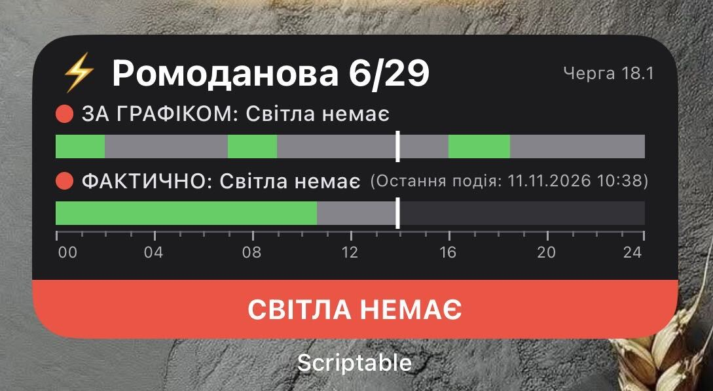
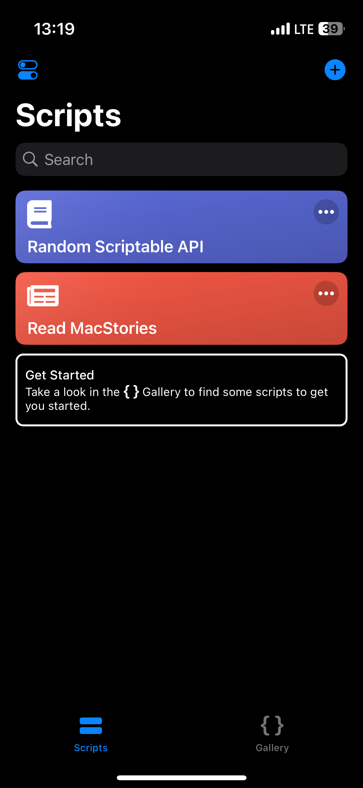
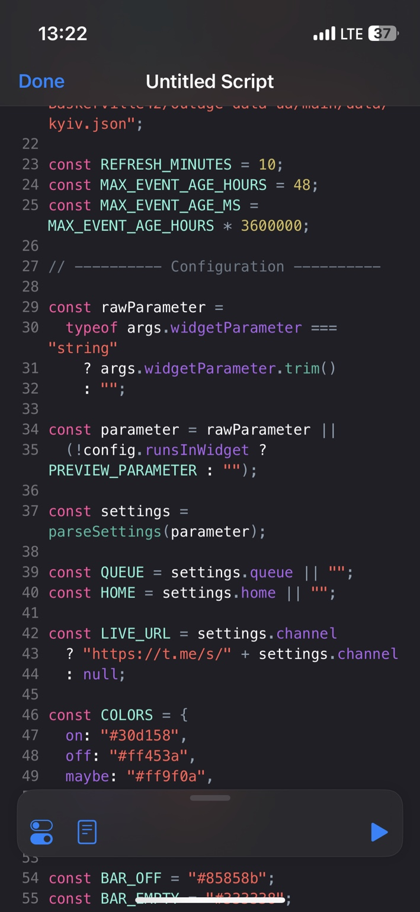
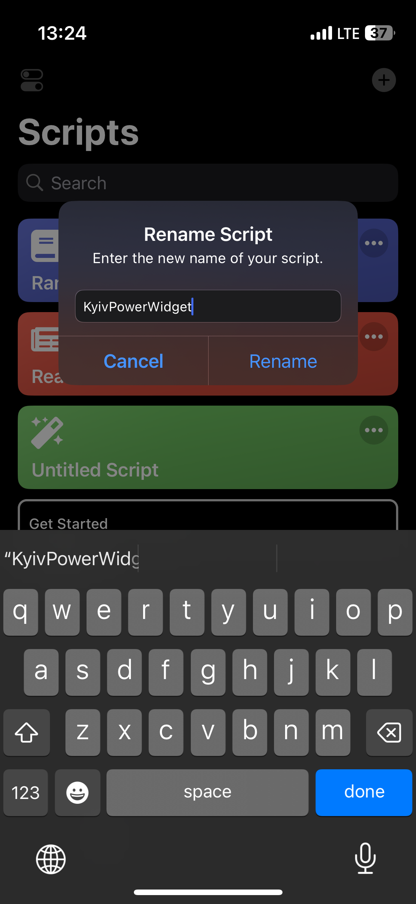
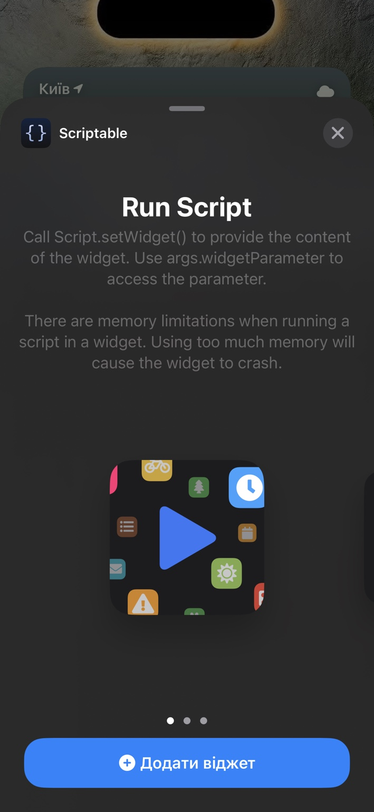
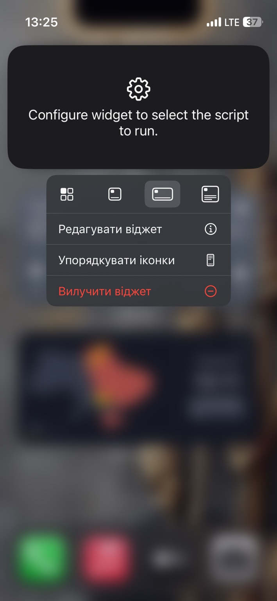
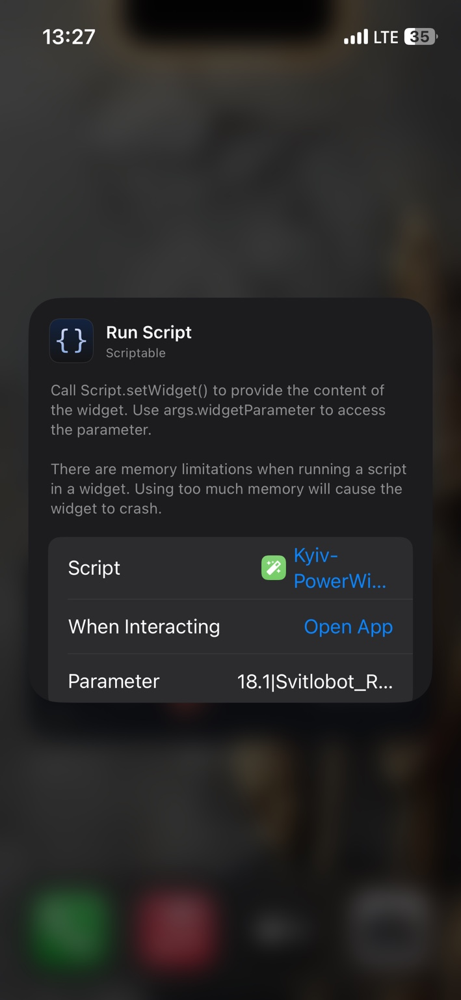
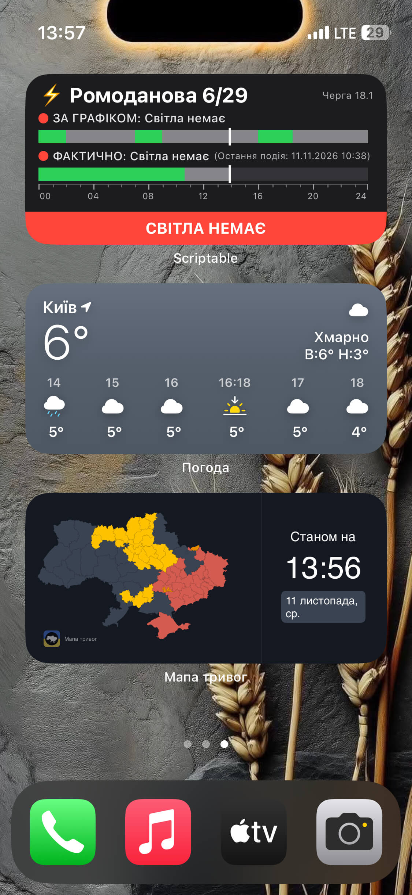

# ⚡ Kyiv Power Widget

**Kyiv Power Widget** — безкоштовний віджет для iPhone, який відображає графік відключень електроенергії в Києві та фактичний стан світла за повідомленнями публічних Telegram-каналів СвітлоБота.



## Що показує віджет

- **ЗА ГРАФІКОМ** — заплановані відключення для вибраної черги.
- **ФАКТИЧНО** — стан електропостачання, визначений за подіями Telegram.
- **Остання подія** — дата й час останньої розпізнаної зміни стану.
- **Дві часові шкали** для порівняння плану й факту та білий маркер поточного часу.
- **Нижня плашка**: зелена — світло є; червона — світла немає; сіра — стан невідомий.
- Формати **Small** і **Medium**, підтримка різних адрес без редагування коду.

## Як встановити на iPhone

### 1. Встановіть Scriptable

Завантажте [Scriptable з App Store](https://apps.apple.com/app/scriptable/id1405459188). Відкрийте додаток і натисніть синю кнопку **+** у верхньому правому куті.



### 2. Скопіюйте та вставте код

1. Відкрийте [`KyivPowerWidget.js`](KyivPowerWidget.js) у цьому репозиторії.
2. Натисніть **Raw** (або скористайтеся меню копіювання файлу) і скопіюйте весь код.
3. Поверніться в Scriptable, вставте код у новий скрипт і натисніть **Done**.



### 3. Перейменуйте скрипт

Новий скрипт спочатку називається `Untitled Script`. На його картці натисніть **••• → Rename**, введіть **`KyivPowerWidget`** і підтвердьте перейменування.



### 4. Додайте віджет на головний екран

1. Затисніть порожнє місце на головному екрані iPhone.
2. Натисніть **+ → Додати віджет** (назви пунктів можуть трохи відрізнятися залежно від iOS).
3. Знайдіть **Scriptable**, оберіть **Medium** (широкий) або **Small** (квадратний) і натисніть **Додати віджет**.



### 5. Відкрийте налаштування віджета

Спочатку на ньому може бути написано `Configure widget to select the script to run.` — це нормально. Затисніть віджет і виберіть **Редагувати віджет**.



### 6. Виберіть скрипт і введіть Parameter

У вікні налаштувань задайте:

- **Script:** `KyivPowerWidget`
- **When Interacting:** можна залишити `Open App`
- **Parameter:** один рядок із даними для вашого будинку

Формат параметра:

```text
черга|telegram_канал|адреса
```

**Приклад:**

```text
18.1|Svitlobot_Romodanova6_29|Ромоданова 6/29
```

Де `18.1` — черга відключень, `Svitlobot_Romodanova6_29` — username **публічного** Telegram-каналу без `@`, а `Ромоданова 6/29` — підпис адреси у віджеті. Важливо: між трьома значеннями має бути символ `|`.



### 7. Завершіть встановлення

Закрийте налаштування й натисніть **Готово** на головному екрані. Віджет завантажить дані для вибраної черги та доступні повідомлення Telegram.



**Готово!**

## Як знайти параметри для своєї адреси

1. Відкрийте [мапу СвітлоБота](https://svitlobot.in.ua/map).
2. Знайдіть свій будинок (або сусідній, з яким збігається графік відключень у вашому будинку) і натисніть його позначку.
3. Перевірте **групу відключень** і посилання на **Telegram-канал**, що відповідає цьому будинку.
4. Вставте власні значення у поле **Parameter** віджета.

Код змінювати не потрібно. Можна встановити кілька віджетів з одним скриптом, але різними параметрами.

**Якщо Telegram-каналу немає:** замість назви каналу введіть дефіс, наприклад:

```text
18.1|-|Ромоданова 6/29
```

У цьому випадку віджет показує **плановий графік**, а фактичний стан не визначає (нижня плашка повідомляє, що стан невідомий).

Також підтримується необов'язкове четверте поле — посилання на сторінку `bezsvitla.com.ua/kyiv/`, яка відкриватиметься після натискання на віджет:

```text
черга|telegram_канал|адреса|посилання
```

## Як читати графік

- **Зелений сегмент:** світло є.
- **Сірий сегмент:** світла немає.
- **Помаранчевий сегмент:** можливе відключення.
- **Темно-сірий сегмент:** немає підтверджених даних.
- **Білий вертикальний маркер:** поточний час.

Зверніть увагу: **«ЗА ГРАФІКОМ» і «ФАКТИЧНО» можуть відрізнятися**. Це не обов'язково помилка: реальне вимкнення або відновлення електропостачання може відбутися раніше чи пізніше запланованого.

## Поширені запитання

**Чому бачу «Configure widget to select the script to run»?**  
У налаштуваннях віджета не вибраний скрипт. Затисніть віджет → **Редагувати віджет** → **Script** → `KyivPowerWidget`.

**Чому написано «СТАН НЕВІДОМИЙ»?**  
Поточний стан не вдалося підтвердити. Наприклад, у Telegram-каналі не було розпізнаної події протягом **48 годин** або канал недоступний. Мапа СвітлоБота може містити свіжіший стан, ніж публічні Telegram-повідомлення.

**Як часто оновлюється віджет?**  
Скрипт запитує оновлення приблизно кожні **10 хвилин**, але iOS сама визначає, коли запускати віджет у фоні. Оновлення не гарантовані точно за розкладом.

**Чи потрібен інтернет?**  
Так. За тимчасової недоступності джерел скрипт може використовувати останню збережену копію даних. Дата графіка та свіжість Telegram-подій перевіряються окремо.

**Чи можна встановити для іншої адреси?**  
Так. Змініть лише **Parameter**. Сам JavaScript редагувати не потрібно.

## Джерела та подяка

- Плановий графік: [Baskerville42 / outage-data-ua](https://github.com/Baskerville42/outage-data-ua).
- Фактичний стан: публічні Telegram-канали [СвітлоБота](https://svitlobot.in.ua/map).
- Ідея віджета: подяка **[@serhiypolyukh](https://www.threads.net/@serhiypolyukh)** у Threads за початкове натхнення.

Це незалежний, неофіційний проєкт. Точність і доступність даних залежать від зовнішніх джерел. Інформація має довідковий характер.
